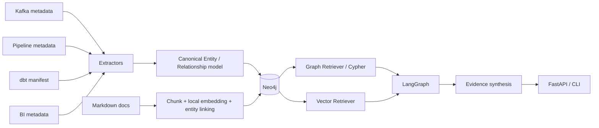

# Architecture

The lab deliberately separates data engineering from agent orchestration.

## Boundary decisions

- **ETL/ELT layer:** extracts deterministic metadata and converts source-specific records into a canonical graph model.
- **Neo4j:** persists connected knowledge, document chunks, provenance, and embeddings.
- **Cypher:** performs graph modeling, lineage, dependency, ownership, and impact queries.
- **RAG:** retrieves relevant document chunks from the Neo4j vector index.
- **LangGraph:** routes a question through graph retrieval, document retrieval, or both, then synthesizes the evidence.
- **LLM:** optional. The local mode remains runnable and prints retrieved evidence without an external model.

## Why no mandatory APOC?

The core path is intentionally Cypher-first. Labels and relationship types are controlled by explicit allowlists, while data values remain parameterized. APOC can be introduced later for a concrete need, but it is not required to demonstrate graph ETL or GraphRAG.
